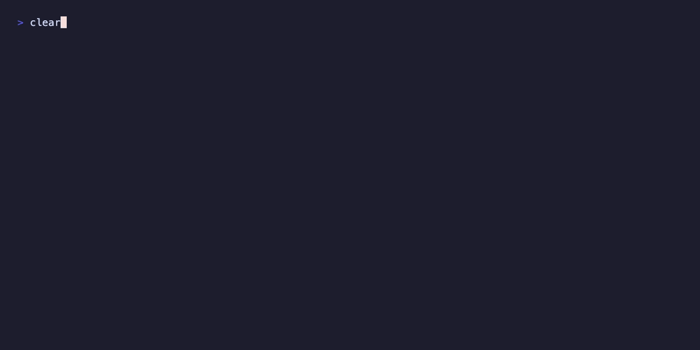

# Claude Code secure setup template

  

Claude Code's permission rules only match the start of a command. A deny rule for `rm *` doesn't stop `r''m -rf x`, `\rm -rf x` or `for f in x; do rm $f; done`. This template closes that gap and locks down the rest of your machine around Claude.

It's a ready-to-use configuration for macOS and Linux (including WSL2). It runs every shell command in a sandbox, keeps Claude away from your credentials, shows what each session costs, makes Claude check current library docs instead of guessing, and installs a short list of reviewed plugins. Use it as is, or keep the security parts and swap the plugins for your own.

```bash
git clone https://github.com/kryo-o/claude-code-setup && cd claude-code-setup && bash install.sh
```



## Default Claude Code vs. this template

| | Default | With this template |
|---|---|---|
| Shell commands | Ask once, then run with your full user access | Run in a sandbox: writes only in the project and temp folders, filtered network |
| SSH keys, cloud credentials, browser cookies, `.env` files | No specific rule | Blocked for both file reads and shell commands |
| Disguised commands (`r''m`, loops, `eval`, base64) | Deny rules check the start of the command only | `deny-guard.sh` scans the whole command and any script it runs |
| Package installs | Normal permission prompt | Always asks, even when sandboxed commands are auto-approved |
| Session cost and plan limits | On demand through slash commands | Always visible in the status line |
| Third-party plugin updates | Install whatever the author pushes | Reviewed copies, frozen until you update them |
| Library APIs | From the model's training data | Looked up in current docs with Context7 |

## What's inside

| File | Purpose |
|---|---|
| `install.sh` | One-command installer: backs up your settings, installs everything, runs the tests |
| `settings.json` | Permissions, sandbox, hook, status line, plugins and marketplaces |
| `hooks/deny-guard.sh` | Blocks dangerous Bash commands, including disguised ones |
| `hooks/deny-guard-test.sh` and `hooks/deny-guard-cases.txt` | 99 test cases for the guard |
| `hooks/statusline.sh` | One-line status: model, context bar, cost, 5h/7d limits, git branch, plugin badges |
| `claude-md/docs-rule.md` | A `CLAUDE.md` rule that makes Claude check Context7 before using a library |
| `mods/vendored-mods/.claude-plugin/marketplace.json` | A local marketplace for frozen copies of third-party mods |

## How it works

### Three security layers

Each layer misses things the others catch.

#### 1. The sandbox

The sandbox is the actual boundary. With `sandbox.enabled: true` and `allowUnsandboxedCommands: false`, every Bash command runs inside the operating system's sandbox: Seatbelt on macOS, bubblewrap on Linux. Commands can only write to the project folder and temp folders, and network access goes through a filter. `autoAllowBashIfSandboxed` skips most permission prompts, which is safe because the sandbox limits what a command can damage.

Two kinds of commands can't work inside the sandbox. `gh` needs your GitHub login, and `git push`, `pull` and `fetch` over SSH can't get through the sandbox's network proxy on macOS. `excludedCommands` runs only these outside the sandbox: `git push`, `pull` and `fetch`, plus the `gh` subcommands `repo`, `release`, `pr`, `issue` and `api`. Any other `gh` command stays sandboxed and fails without your login. Claude asks before every one of them, so publishing stays your decision.

The exclusion only applies when the command starts with `git` or `gh`. A command like `cd repo && git push` stays sandboxed and fails, so start Claude inside the repo folder. If you'd rather run these commands yourself, delete the `excludedCommands` line.

These commands run with your full access, so the template blocks everything that could make them run other code or leak your token:

- git options that run a program: `--upload-pack`, `--receive-pack` and `--exec` (including abbreviated forms), `git -c` overrides, and environment overrides such as `GIT_SSH_COMMAND`
- `git config` keys that run commands, and `git credential`
- `gh extension`, `gh alias`, the `gh auth` commands that touch the token, and `gh repo delete`
- `gh api` DELETE calls and GraphQL mutations
- edits to `.git/hooks` and `.git/config`, including those of submodules and worktrees, so Claude can't plant a hook that runs on your next push

#### 2. Permission rules

| Rule | Covers | Why |
|---|---|---|
| `Read` deny | SSH keys, cloud credentials, package registry and git tokens, Claude Code's own login on Linux, browser cookies, the keychain, shell history, `.env` files, iCloud | Keeps secrets out of Claude's reach |
| `Bash` deny | `rm`, `sudo`, force-pushes, `curl \| bash` | Destructive, or runs code from the internet |
| `Edit` deny, your machine | Claude Code's settings, hooks, plugins, mods, skills, agents, commands, rules and global `CLAUDE.md`; shell startup files; `~/.gitconfig`, `~/.config/git`, `~/.config/gh` and `~/.ssh`; login items (`~/Library/LaunchAgents` on macOS, systemd user units and autostart on Linux) | Claude can't change its own guardrails or plant code that runs later |
| `Edit` deny, every project | `.claude/settings.json`, `.claude/settings.local.json`, `.claude/hooks`, `skills`, `agents`, `commands` and `rules`, and `.mcp.json` | Project settings override yours, so one planted file could turn off the sandbox or add a hook |
| `ask` | Package installs | Dependencies don't get added without you noticing |
| `ask` | Memories in `~/.claude/projects/*/memory/`, and every `CLAUDE.md` and `CLAUDE.local.md` | Every session loads them as instructions, so a prompt injection saved there would last |

Claude Code also applies the `Read` and `Edit` deny rules to the sandbox, so shell commands can't read or write those paths either. To change any of the denied files, edit them yourself.

Without these rules, Claude Code only asks before writes to a project's `.claude/` folder, and in auto mode a classifier answers instead of you. That's why the template denies these writes outright. The project rules start with `//**/` because a rule like `**/.claude/...` only matches under the folder Claude started in.

Memories and `CLAUDE.md` files get an `ask` rule instead of a deny, because you still want Claude to write them. Claude Code otherwise saves memories without asking, and a committed `CLAUDE.md` reaches everyone who clones the repo. The `CLAUDE.md` rules match any letter case, because macOS treats `claude.md` and `CLAUDE.md` as the same file. `sandbox.filesystem.denyWrite` stops shell commands from writing them, so every edit goes through the prompt. In headless mode (`claude -p`), an `ask` rule acts as a deny, so these writes fail there.

#### 3. The deny-guard hook

The `deny-guard.sh` hook covers a gap in those rules. Permission rules only match the start of a command, so `for f in x; do rm $f; done` or `r''m` gets past them. The hook searches the whole command, plus any script the command runs, for deletes, `eval`, base64-decoded commands, pipes into a shell and credential paths. It also blocks the common shell writes to `CLAUDE.md` (`>`, `tee`, `sed -i`, `cp`, `mv`) in any letter case. Text matching can always be worked around, so treat the hook as a speed bump and rely on the sandbox. Run `bash ~/.claude/hooks/deny-guard-test.sh` to test it.

One quirk: the hook decides which scripts to read by file extension. If a harmless command mentions a `.sh` or `.ts` file that happens to contain `eval` or `.env`, the hook blocks it.

### Third-party mods are frozen after review

Plugins and mods run code on your machine, and an update can replace that code with anything. The official Anthropic plugins update normally. The two third-party mods get more access than unreviewed code should have: `reflect-mod` writes to `CLAUDE.md`, and `cache-tax` sends model requests in the background. So the template installs them from a local `directory` marketplace, pinned to reviewed commits. They only change when you copy in a new version yourself.

| Mod | Source | Reviewed commit |
|---|---|---|
| reflect-mod 3.3.0 | `bayramannakov/claude-reflect` | `b6c42326903af3dd2bf3772b979730a44d8548ca` |
| cache-tax 2.2.1 | `karanb192/claude-code-mods` | `06cac47ec125a41a4aeeb78a6b006bec8cc6d6ed` |

This repo doesn't include their code. The install steps below have you download and review it yourself.

### Plugins

From Anthropic's official marketplace:
- `security-guidance` warns about risky code as files are edited and reviews the changes at the end of each turn.
- `claude-security` runs a deep scan on demand and checks each finding before reporting it.
- `mattpocock-skills` adds skills for TDD, debugging, code review, PR writing and more.
- `context7` (by Upstash) connects Claude to Context7, a service that serves current, version-specific documentation for libraries. The installer adds a rule to `~/.claude/CLAUDE.md` telling Claude to look up docs there before writing code that uses a library. It works without an account; set `CONTEXT7_API_KEY` for higher rate limits. Library names and your doc questions go to Upstash's servers.
- `blast-radius` and `replay-theater` come from `anthropics/claude-code-playground`. The first previews what a risky shell command would change; the second replays Claude's edits as diffs.

From the community:
- `caveman` makes replies terse, which saves output tokens.
- `ponytail` pushes Claude toward the simplest code that works (YAGNI, standard library first).
- `humanizer` removes AI-sounding patterns from prose.
- `reflect-mod` turns your corrections into `CLAUDE.md` rules, and you approve each one.
- `cache-tax` warns before an expensive resend after the prompt cache expires, and `/keepwarm` keeps the cache alive while you're away.

Optional, for specific kinds of work. Delete the ones you don't need from `settings.json` before step 4:
- `commercial-legal` and `privacy-legal` (Anthropic) review contracts, data processing agreements and privacy impact assessments.
- `claude-seo` runs SEO audits.
- `nateherk-design` builds landing pages that animate as you scroll.

### Status line

```
Opus | ████░░░░░░ 42% | $1.50 | 5h:12% 7d:30% | ⎇ main | [CAVEMAN] | [PONYTAIL]
```

It shows how full the context window is, what the session has cost and how much of your plan's usage limits you've used, so a runaway session is easy to spot. It finds the plugin badges by searching the plugin cache, so they survive plugin updates. It needs `jq`, which comes with macOS 15 and later; on Linux, install it with your package manager.

## Install

### Quick install

```bash
git clone https://github.com/kryo-o/claude-code-setup && cd claude-code-setup && bash install.sh
```

The installer needs `claude`, `git`, `jq` and `rsync`. On Linux it also needs `bubblewrap` and `socat`, which Claude Code's sandbox uses; on Debian or Ubuntu, install everything with `sudo apt install jq rsync bubblewrap socat`. It backs up your current `settings.json` with a timestamp, asks before installing the two third-party mods (and pauses so you can review their code), adds the Context7 rule to `~/.claude/CLAUDE.md` without touching your existing rules, installs every plugin and runs the guard tests. Running it again is safe.

### Manual install

These are the same steps the installer runs.

### Step 0: prepare

Clone this repo. Back up your current `~/.claude/settings.json` if you have one, because step 3 overwrites it. Make sure `jq` is installed, since the install loop and the status line both use it. On Linux, the sandbox also needs `bubblewrap` and `socat`:
```bash
which jq || brew install jq                         # macOS
sudo apt install jq rsync bubblewrap socat          # Debian/Ubuntu
```

### Step 1: get the Anthropic playground mods

```bash
mkdir -p ~/.claude/mods
git clone https://github.com/anthropics/claude-code-playground ~/.claude/mods/claude-code-playground
```

### Step 2: freeze the third-party mods

Install each mod from upstream, review it, copy it into your local marketplace, then remove the upstream version:
```bash
claude plugin marketplace add bayramannakov/claude-reflect
claude plugin install reflect-mod@claude-reflect-marketplace
claude plugin marketplace add karanb192/claude-code-mods
claude plugin install cache-tax@claude-code-mods
```
Read the code in `~/.claude/plugins/cache/claude-reflect-marketplace/reflect-mod/<version>/hooks/` and `~/.claude/plugins/cache/claude-code-mods/cache-tax/<version>/hooks/`. If the versions are newer than the ones in the table above, the code hasn't been reviewed yet, so read it closely.

Then copy them and remove the upstream installs:
```bash
V=~/.claude/mods/vendored-mods; C=~/.claude/plugins/cache
mkdir -p $V
rsync -a --exclude .in_use $C/claude-reflect-marketplace/reflect-mod/*/ $V/reflect-mod/
rsync -a --exclude .in_use --exclude site --exclude docs --exclude .github $C/claude-code-mods/cache-tax/*/ $V/cache-tax/
claude plugin uninstall reflect-mod@claude-reflect-marketplace
claude plugin uninstall cache-tax@claude-code-mods
claude plugin marketplace remove claude-reflect-marketplace
claude plugin marketplace remove claude-code-mods
```

### Step 3: copy this config in

Run these from inside this repo's folder:
```bash
cp -R mods/vendored-mods/.claude-plugin ~/.claude/mods/vendored-mods/
mkdir -p ~/.claude/hooks && cp hooks/* ~/.claude/hooks/ && chmod +x ~/.claude/hooks/deny-guard.sh
sed "s#__HOME__#$HOME#g" settings.json > ~/.claude/settings.json
cat claude-md/docs-rule.md >> ~/.claude/CLAUDE.md
```

### Step 4: install every marketplace and plugin

Don't count on the prompts Claude Code shows at first start. Copying `settings.json` on its own can leave plugins half-installed, and some (caveman and ponytail, for example) then fail on startup. This loop reads both lists from your new `settings.json`, removes any existing copy of each plugin and installs it again. If plugins break later, run it again:
```bash
S=~/.claude/settings.json
claude plugin marketplace add anthropics/claude-plugins-official   # usually already there
for m in $(jq -r '.extraKnownMarketplaces[].source | .repo // .path' $S); do
  claude plugin marketplace add "$m"
done
for p in $(jq -r '.enabledPlugins | keys[] | select(endswith("@builtin") | not)' $S); do
  claude plugin uninstall "$p" 2>/dev/null
  claude plugin install "$p"
done
```
You can ignore "already added" and "not installed" messages. Each install line should end with `✔ Successfully installed`.

### Step 5: check and start

```bash
bash ~/.claude/hooks/deny-guard-test.sh   # should print: all cases pass
claude
```
In Claude Code, run `/plugin` and check that every plugin listed in `settings.json` is installed (15 if you kept them all). The status line should appear at the bottom of the screen.

## Loosening the rules for one project

The rules in `~/.claude/settings.json` are strict on purpose, and Claude can't change them. If they get in the way in one project, you can relax them there yourself with `.claude/settings.local.json` in that project. Claude Code keeps this file out of git, it only applies to that project, and it takes precedence over your user settings. For example, to let Claude fetch your team's docs and give it access to a sibling folder:

```json
{
  "permissions": {
    "allow": ["WebFetch(domain:docs.example.com)"],
    "additionalDirectories": ["../shared-lib"]
  }
}
```

Use `.claude/settings.json` instead for rules the whole team should share through git.

What a project file can't do:
- Remove a `deny` rule or skip an `ask` rule from your user settings. A deny rule wins wherever it's defined, and an ask rule still prompts even when a project `allow` rule matches.
- Be written by Claude. This template denies `Edit` on every project's `.claude/settings.json`, `.claude/settings.local.json`, `.claude/hooks`, `skills`, `agents`, `commands`, `rules` and `.mcp.json`. Write these files yourself, or add rules with `/permissions`, which Claude Code saves without going through Claude's tools.

A project file can still turn the sandbox off or add hooks, so keep these files short and read them before you commit. When you open a cloned repo, Claude Code asks you to trust the folder before it uses that repo's `.claude/settings.json`. Read the file before you say yes.

## Moving to another machine

Copy `settings.json`, `CLAUDE.md`, `hooks/` and `mods/` from `~/.claude`. Leave out `plugins/cache` and `plugins/marketplaces`. On the new machine:

1. Unzip into your home folder.
2. If your username is different, fix the paths: `sed -i.bak "s#/Users/OLDNAME#$HOME#g" ~/.claude/settings.json` (on Linux the old path starts with `/home/`).
3. Run the step 4 loop to install every plugin.

## Notes

- Works on macOS and Linux, including WSL2 (WSL1 has no sandbox support). The permission rules cover both systems' credential paths: Keychains and `Library/Application Support` on macOS; `~/.config` browser profiles, `~/.mozilla`, GNOME keyrings and `pass` on Linux. Rules for paths that don't exist on your system do nothing.
- On Ubuntu 24.04 and later, AppArmor stops bubblewrap from working until you add a profile for it. See [Set up Linux and WSL2](https://code.claude.com/docs/en/sandboxing) in the Claude Code docs; `/sandbox` in Claude Code shows whether anything is missing.
- Linux support is newer and less tested than macOS. Please report problems with the bug report form.
- The status line script and the hook live in `~/.claude/hooks/`, which the sandbox never lets shell commands write to. Both run outside the sandbox with your full access, so they must not be editable by a sandboxed command.
- `cache-tax` pings and `security-guidance` reviews are model calls, so they count toward your plan's limits.
- Keep the sandbox on. The hook and the permission rules can be worked around; the sandbox is what actually limits damage.

## Credits

This template only wires things together. The plugins are other people's work, so if one helps you, star its repo:

- [caveman](https://github.com/JuliusBrussee/caveman) by Julius Brussee
- [ponytail](https://github.com/DietrichGebert/ponytail) by Dietrich Gebert
- [humanizer](https://github.com/blader/humanizer) by blader, based on Wikipedia's [Signs of AI writing](https://en.wikipedia.org/wiki/Wikipedia:Signs_of_AI_writing) guide by WikiProject AI Cleanup
- [claude-reflect](https://github.com/bayramannakov/claude-reflect) (reflect-mod) by Bayram Annakov
- [claude-code-mods](https://github.com/karanb192/claude-code-mods) (cache-tax) by Karan Bansal
- [skills](https://github.com/mattpocock/skills) by Matt Pocock
- [Context7](https://github.com/upstash/context7) by Upstash
- [claude-seo](https://github.com/AgriciDaniel/claude-seo) by AgriciDaniel
- [scroll-craft](https://github.com/nateherkai/scroll-craft) by Nate Herk
- [claude-code-playground](https://github.com/anthropics/claude-code-playground), [claude-for-legal](https://github.com/anthropics/claude-for-legal), and the official marketplace plugins `security-guidance` and `claude-security` by Anthropic

## Disclaimer

Only `reflect-mod` and `cache-tax` are frozen at a reviewed version. Every other plugin and skill this template installs comes straight from its author's repository and can update when the author pushes a new version. That includes the community plugins (caveman, ponytail, humanizer, claude-seo, nateherk-design) and third-party plugins listed in Anthropic's marketplace (mattpocock-skills, Context7). Whether an update installs automatically depends on each marketplace's auto-update setting.

An update can change what a plugin does on your machine, and nobody behind this template reviews those updates. Keeping auto-update on is your decision and your risk. To check each version before it installs, open `/plugin` in Claude Code, go to Marketplaces, and turn off auto-update for the marketplaces you don't fully trust. Or freeze those plugins the same way this template freezes `reflect-mod` and `cache-tax`.

This template is provided as is, without warranty of any kind (see the MIT [LICENSE](LICENSE)). You are responsible for what you install and run.

## License

MIT. See [LICENSE](LICENSE). The plugins and mods this template installs keep their own licenses. Changes between versions are in [CHANGELOG.md](CHANGELOG.md).
